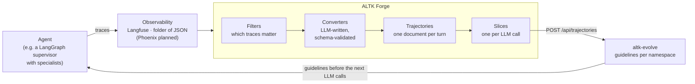
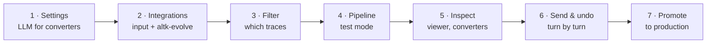
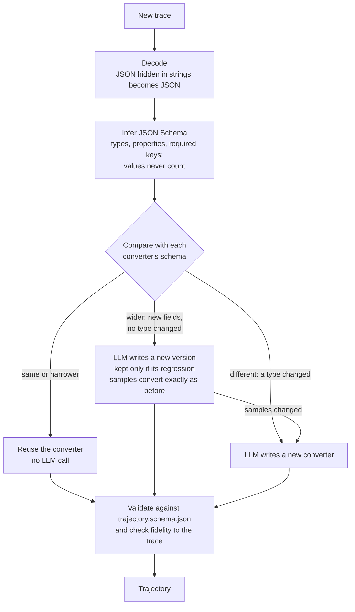
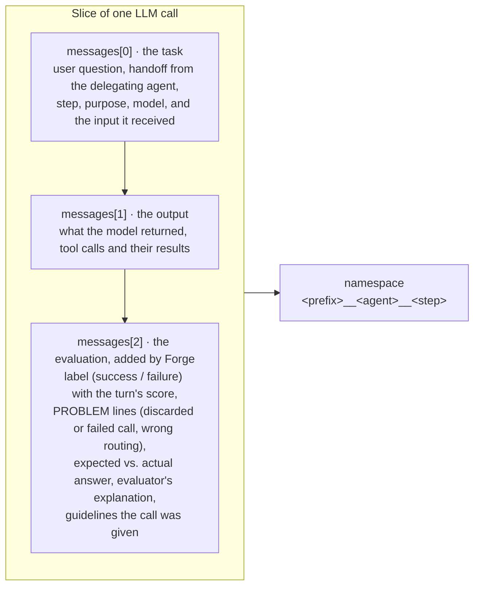

# ALTK Forge

**See how your agent's memory is made, and what it does to the next run.**

ALTK Forge is the ingestion server between an agent's observability traces and [altk-evolve](../README.md) memory. It turns traces into unified trajectories, sends them to memory one LLM call at a time, and shows which guidelines came from which call and which later calls received them.

## Why

A single agent turn fans out into routers, sub-agents, retries, tools and retrieval, often dozens of LLM calls. Langfuse records them, and altk-evolve turns trajectories into guidelines, but between the two nobody can see:

- what was actually sent to memory, and under which namespace;
- which guidelines memory generated, and from which call;
- which later calls received those guidelines, and what they did there.

Forge makes each of these visible, so you can tune memory with evidence instead of guessing.

## How it works

```
 observability              ALTK Forge                               memory
 (Langfuse, folder) ──►  filter → settle → convert → slice  ──►  (altk-evolve)
                                                                     │ guidelines
                          agent's next runs  ◄───────────────────────┘
```

1. **Integrations** are connections. Inputs: Langfuse, or a folder where every `*.json` file is one trace (optionally recursive, with exclude patterns). Output: an altk-evolve server.
2. **Filters** select Langfuse traces by name, time, user, session, tags, metadata, scores, latency, tokens, errors and more. Langfuse applies them on its side.
3. **Pipelines** combine inputs, filters and one output. The worker polls each enabled pipeline (`poll_seconds`, default 60). It waits until a trace has not changed for `settle_seconds` (default 120), so late scores are included. It converts each trace once and validates it against [trajectory.schema.json](altk_forge/trajectory/schema/trajectory.schema.json). Each LLM call becomes one slice, and the slices go to altk-evolve (`POST /api/trajectories` with a processing profile). Forge records the entities each slice produced.
4. **Modes.** A new pipeline starts in **test** mode: you send turns one by one or all at once, and you can undo exactly what each one produced. **Promote** a pipeline to **production** and it sends new trajectories automatically, retrying failed sends.
5. **The viewer** shows each turn as a timeline of spans, the full input and output of every call, the slices sent to memory (and the calls left out, with the reason), the guidelines that came back, and where guidelines from memory appeared in later prompts.

### Generated converters

An LLM writes the converters, one per trace *shape*. Values never decide which converter is used.

- The trace is normalised: JSON encoded inside strings is decoded. A JSON Schema is then inferred from it, and data-like keys (ids, hashes) become maps.
- **Same or narrower** schema as an existing converter: that converter is reused, with no LLM call.
- **Wider** (new fields, no type changed): the LLM writes a new version. The new version is kept only if it reproduces its regression samples exactly; otherwise a separate converter is written.
- **Different:** a new converter is written.

The LLM gets validation errors back until its output passes. Generated code runs in a separate process with a time limit and may import only `json, re, math, datetime, itertools, collections, functools, copy, hashlib, string, typing, statistics, textwrap, html, unicodedata, urllib.parse, jsonschema`. It cannot use files, the network or processes. Every version is kept in `.data/pipelines/<id>/converters/`, and you can read it in the console.

### Namespaces

When an LLM call reads guidelines from one namespace but its slice is saved to another, memory has no effect, and nothing reports it. The agent therefore records in the metadata of every generation the namespace it read from. Forge saves the slice to that same namespace:

| Metadata key | Meaning |
|---|---|
| `memory_namespace` | namespace the call read from (`<prefix>__<agent>__<step>`) |
| `memory_step` | stable step id (`<agent>.<purpose>`) |
| `memory_query` | text the guidelines were selected by (sent as slice metadata) |
| `memory_guideline_ids` | guidelines the call received |
| `memory_enabled` | whether memory was on; record the fields even when it is off |

For traces without `memory_namespace`, Forge derives `<prefix>__<agent>__<purpose>`; the prefix defaults to the pipeline id. A pipeline can instead set `namespace_mode: single` with a fixed `namespace_id`. The agent puts the guidelines it receives in a `# Guidelines from memory` section of its prompt; the viewer looks for that heading to show where guidelines landed.

## Installation

The tool needs [uv](https://docs.astral.sh/uv/) and Python 3.11+. Run these commands from this folder:

```sh
uv sync                     # dependencies pinned in uv.lock
uv run altk-forge           # console + viewer on http://127.0.0.1:8999, worker in the background
```

### Opening the console

Once the server prints `ALTK Forge: http://127.0.0.1:8999 (...)`, open **http://127.0.0.1:8999** in a browser. That page is the admin console, with the **Pipelines**, **Observability filters**, **Integrations** and **Settings** tabs. A pipeline's **Open viewer** button opens the trajectory viewer at `http://127.0.0.1:8999/viewer.html?pipeline=<pipeline id>`.

- If you started the server with `--port 9000`, the address is `http://127.0.0.1:9000`.
- The server listens on localhost only, because it holds the integrations' secrets. To reach a Forge running on another machine, use an SSH tunnel rather than `--host 0.0.0.0`:

  ```sh
  ssh -L 8999:127.0.0.1:8999 user@forge-host   # then open http://127.0.0.1:8999 locally
  ```

Server options: `--host` (default `127.0.0.1`), `--port` (default `8999`), `--no-worker`.

### Without the UI

Run the worker alone, on a server or from cron:

```sh
uv run altk-forge-worker                        # run enabled pipelines until stopped
uv run altk-forge-worker --once [--pipeline ID] # one poll, exit code 1 on failure
uv run altk-forge-worker --list                 # pipelines and their counts
```

Do not run the server's worker and `altk-forge-worker` on the same data folder. To use both, start the server with `--no-worker`.

### Installing it as a tool

Forge is also a regular Python package. Installed from this folder, the `altk-forge` and `altk-forge-worker` commands work from any folder, and they keep `.env` and `.data/` in the folder they are started from:

```sh
uv tool install .           # or: pip install .
cd ~/forge && altk-forge
```

### Tests

The tests run offline: the LLM and altk-evolve are stubbed, and data goes to a temporary folder.

```sh
uv run pytest -v
```

## Configuration

| Setting | Where |
|---|---|
| LLM that writes converters (any OpenAI-compatible endpoint; a LiteLLM proxy is the intended one) | console **Settings**, or `LLM_BASE_URL`, `LLM_MODEL`, `LLM_API_KEY` |
| Initial Langfuse integration (created on first run) | `LANGFUSE_HOST`, `LANGFUSE_PUBLIC_KEY`, `LANGFUSE_SECRET_KEY` |
| Data folder | `FORGE_DATA` (default `.data/` in this folder; for an installed tool, in the folder it is started from) |
| altk-evolve output | integration with `host` (default `http://127.0.0.1:8000`) and optional `api_key` |
| Guideline generation per pipeline | `guidelines_mode`, `consistency_method`, `guidelines_model`, `custom_llm_provider`, segmentation and trimming limits; empty fields fall back to the altk-evolve server's `EVOLVE_*` environment |

Environment variables can also be set in a `.env` file next to `.data/`; variables already set in the environment take precedence. Values saved in the console take precedence over the environment.

**Security.** The server binds to localhost and refuses write requests from other origins. Secrets are kept in `.data/integrations.json` and `.data/settings.json` with mode `0600`. Do not commit `.data/`.

## Data layout

```
.data/
  settings.json, integrations.json, filters.json
  pipelines/<id>/
    pipeline.json      definition and run history
    state.json         processed traces and watermarks
    trajectories/      <trace_id>.trajectory.json, index.json
    converters/        generated converters, versions, schema.json, samples
    memory.json        what each trace sent to memory (namespaces, entity ids)
    worker.log         last 2 MB of worker activity
```

Traces are not copied: they are read from the source when needed.

## Supported

| | |
|---|---|
| Input | Langfuse, filesystem (JSON traces). Arize Phoenix: connection test only. |
| Output | altk-evolve |
| Formats | [trajectory.schema.json](altk_forge/trajectory/schema/trajectory.schema.json) (v2.0), [session.schema.json](altk_forge/trajectory/schema/session.schema.json) |

## Layout

Forge is a Python package, `altk_forge`, in a uv project of its own. It is built in layers: each one depends only on
the layers above it, never on the ones below.

```
altk_forge/
  core/          where files live, errors, time, ids, JSON storage
  trajectory/    the unified trajectory: schemas and validation, spans, summary, guidelines in prompts, slices
  sources/       where traces come from: Langfuse, a folder of JSON files, Phoenix; filters as Langfuse queries
  memory/        where trajectories go: the altk-evolve client
  llm.py         the LLM Forge itself calls (to write converters), and its settings
  builtin/       hand-written converters: Langfuse traces of LangGraph agents, flat OpenAI messages
  converters/    converters written by the LLM
    schema         a trace's JSON Schema and how it compares with a converter's
    engine         which converter handles a trace: reuse, extend or write one
    writer         having the LLM write or extend a converter until it passes every check
    prompts        what the LLM is asked
    checks         whether a trajectory is valid and faithful to its trace
    store          converters on disk: versions, schemas, regression samples
    sandbox        running generated code in its own process (run_converter.py)
  pipelines/     integrations, filters and pipelines
    integrations   connections (inputs and the altk-evolve output)
    filters        observability filters, and the traces they select
    manage         creating, promoting, purging and deleting pipelines
    state          what a pipeline is and what it has processed
    trajectories   the trajectories it produced, and their slices
    sending        sending trajectories to memory, slice by slice
    worker         the background worker: poll, convert, send
    runtime        what the worker, the senders and the API share: locks, status, cancel, wake
    log, kinds, migrations
  web/           the HTTP server (`altk-forge`), the JSON API, the console and the viewer
  cli/           the worker (`altk-forge-worker`) and offline tools
tests/           offline tests (`uv run pytest -v`)
```

The offline tools convert and check files without a server:

```sh
uv run python -m altk_forge.cli.build --traces <dir> --out <dir>                 # Langfuse exports -> trajectories
uv run python -m altk_forge.cli.convert langfuse <trace.json> <out.json>         # one Langfuse export
uv run python -m altk_forge.cli.convert messages <flat.json> <out.json>          # OpenAI messages -> trajectory
uv run python -m altk_forge.cli.validate <file.json> [...]                       # check trajectories and sessions
```

## User guide

This section walks through what ALTK Forge does and how to use it, from the first connection to a pipeline in production.

### Where Forge fits

Observability tools (Langfuse, Phoenix) record every agent turn as a trace, built for people who debug and monitor. altk-evolve needs trajectories to learn from. Nothing owned the conversion between the two, and the trace formats keep changing as agents, SDKs and fields change. Forge is that missing layer: a server that reads traces, recognises their shape, converts them, sends them to memory and shows every step.



Any number of observability tools and projects can feed the same memory, or separate ones, by configuration only: no code in the agent and no hand-written converter.

### What it does

| Problem | What Forge does about it |
|---|---|
| **No visibility.** Traces live in observability, guidelines in memory, and nothing shows the path between them. | The viewer shows, call by call, what went to memory, what came back, and where the guidelines landed in later prompts. |
| **Traces are not trajectories.** Every platform and SDK has its own shape, and strings hide encoded JSON. | Each trace is decoded and converted into one schema-validated [trajectory](altk_forge/trajectory/schema/trajectory.schema.json). |
| **Traces keep changing.** A hand-written converter breaks or silently drops data. | Converters are written and extended by an LLM, versioned, and guarded by regression samples. |
| **Namespaces must match.** If a call reads guidelines from one namespace and its trajectories go to another, memory does nothing. | Slices are saved to the namespace the agent recorded it reads from (see [Namespaces](#namespaces)). |
| **Loading is not the agent's job.** | Filtering, waiting for traces to settle, converting, sending, retrying and cleaning up run in Forge's background worker. |
| **Experimenting is risky.** | A pipeline starts in test mode: send turns one by one and undo exactly what each produced. |

Forge has three parts:

- **Background worker**: polls every enabled pipeline, waits for traces to settle, converts each trace once, and sends trajectories in production mode.
- **Admin console** (`/`): integrations, filters, pipelines, central LLM settings, converters, worker log and runs.
- **Trajectory viewer** (`/viewer.html`): the timeline of every span, what went to memory and what came back, and guidelines marked where they landed.

### Step by step



**1. Configure the LLM** (**Settings**). Forge uses one LLM, for writing and extending converters. Give it any OpenAI-compatible endpoint; a LiteLLM proxy is the intended one, because it routes the model name to the provider behind it, so Forge is not tied to one vendor. Set the endpoint, the model name the proxy knows and the key, then **Test the model**. Instead of the console, you can also set `LLM_BASE_URL`, `LLM_MODEL` and `LLM_API_KEY`.

**2. Add integrations** (**Integrations** → **Add an integration**).
- **Input**: either **Langfuse** (host, public key, secret key) or **Filesystem** (an absolute folder path, optionally recursive, with exclude patterns such as `metadata.json, results*.json`). In a folder, every `*.json` file is one trace.
- **Output**: **altk-evolve**, which needs the host and, if auth is on, an API key.
- Secrets are shown only as their last 4 characters. **Test connection** checks the credentials, and the list shows which pipelines use each integration.
- The altk-evolve integration holds only the connection. Namespaces and guideline generation are set on each pipeline.

**3. Create an observability filter** (**Observability filters** → **Add an observability filter**; Langfuse only). Filters can select by:
- trace name, with `=`, `contains`, `starts with` or `ends with`;
- a time range, with presets, in local time or UTC (leave **To** empty to keep taking new traces);
- user, session, environment, tags, release, version and bookmarks;
- conditions on metadata, scores, latency, tokens, cost and error or warning counts.

**Count matching traces** shows how many traces the filter selects right now. One filter can serve many pipelines. A folder input takes no filters.

**4. Create a pipeline** (**Pipelines** → **New pipeline**). Choose:
- one or more inputs, each with its filters, and the altk-evolve output;
- where trajectories go: **one namespace per agent and step** (`<prefix>__<agent>__<step>`; the prefix defaults to the pipeline id) or **one namespace** for everything;
- guideline generation: processing profile, guidelines mode, consistency method, model, provider, segmentation and trimming limits. Empty fields fall back to the altk-evolve server's defaults, and Forge creates the processing profile and keeps it in sync;
- `poll_seconds` (default 60) and `settle_seconds` (default 120).

A new pipeline starts in **test** mode.

**5. Watch it work and inspect the results.** The pipeline card shows:
- the flow (input → converters → altk-evolve);
- live counts: trajectories, failed conversions (with **retry** and the reason), turns sent, entities in memory;
- the worker state (last and next check; **Check now** polls immediately) and the **Worker log**.

Click **View code** on a converter to see:
- **Code**: what the converter does, described by the LLM at the top of the file;
- **Changes**: the diff from the previous version;
- **JSON Schema**: the schema of the traces it handles;
- **History**: why each version was written, from which trace, and at what token cost.

**Open viewer** shows each turn on one screen: the question, the answer and the expected answer; scores, duration, LLM calls, tokens and guideline counts; and a timeline of agents, LLM calls, tools and retrieval. `+n gl` marks the calls whose prompt held guidelines from memory. Every input message is labelled by what it is: system prompt, user, handoff, memory, retrieved context or tool result.

**6. Send to memory and undo (test mode).** In the viewer, click the **Memory** button of a turn (**Memory · not sent**, **Memory · sent**) to see what the turn sends: one slice per LLM call, each with its label (success, failure or unknown), its namespace, and the checks behind the label. Then:
- **Send this turn to memory** sends the slices, and the guidelines altk-evolve generated appear under the slice that produced them;
- **Delete what it produced in memory** removes exactly those entities again;
- **Send all** on the pipeline sends every trajectory not yet in memory;
- **Delete everything it produced** resets the test.

**7. Promote to production.** When the results look right, click **Promote to production**. From then on, the worker sends every new trajectory automatically and retries failed sends, and the pipeline keeps what it produced: it can no longer be purged or have its converters deleted.

### How converters are chosen

An LLM writes the converters, but only when a trace has a shape the pipeline has not seen. For a known shape, no LLM call is made.



Every converter is:
- **readable**: plain Python you can view in the console;
- **versioned**: every version is kept;
- **validated**: every trajectory is checked against the schema, and against the trace for missing agents, LLM calls or tools;
- **regression-safe**: a new version must reproduce the earlier trajectories exactly;
- **sandboxed**: a separate process with a time limit and an allow-list of modules, with no access to files, the network or other processes.

When the LLM's code fails these checks, the problems are sent back to it, up to 3 attempts.

### What a slice carries

Each LLM call of a turn becomes one slice, sent to its own namespace. altk-evolve decides whether a slice is worth a guideline. Forge sends every call, including failed and discarded ones, and says in the slice what went wrong.



For example, the evaluation can say that a router chose an agent named `db2_qna` when `db2_q&a` was expected. From that, altk-evolve can learn "route to the exact agent name", in the router's own namespace.

### Closing the loop

The agent reads guidelines from its namespace before an LLM call and puts them into its prompt under a `# Guidelines from memory` heading. Its next traces therefore contain the guidelines, and the viewer:
- highlights that block inside the prompt the model actually received;
- lists the guidelines above the call, with their memory ids;
- shows, per turn, every distinct guideline and the calls that received it.

Each guideline also keeps its origin: the turn and the call it was learned from. So you can follow a lesson both ways, from the call it came from to the later calls it changed, and compare the same question before and after memory.

Every step learns separately. In a multi-agent turn, a router's `route` step, a specialist's `query_rewrite` step and its `answer` step each get their own guidelines, from their own namespace.

### Roadmap: a memory contract

Today the agent and Forge agree on namespaces only through the names recorded in the traces. The next step is an explicit contract, shared by the agent and Forge, that defines:
- **integration points**: which agents and LLM calls take part, with stable step ids;
- **namespace layout**: per call, shared between calls, per agent, or strictly separate;
- **reading**: memory on or off, the query, how many guidelines, where in the prompt;
- **writing**: which calls are sent, and the generation settings;
- **identification**: the metadata a trace must carry, and the contract version.

The agent would then read and write memory only at the contract's points. Forge would convert, slice and send according to the contract, and report traces that break it instead of guessing. A new layout would be a change to one file.
